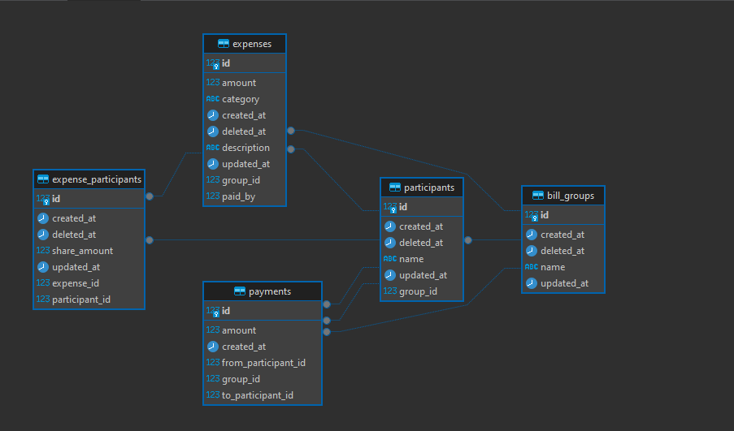

# Split Bill API

Backend REST API untuk membantu kelompok dalam mengelola pengeluaran bersama dan menghitung settlement, yaitu menentukan siapa yang harus membayar kepada siapa dan berapa jumlah yang harus dibayarkan.

---

# Cara Menjalankan Program

Pastikan terlebih dahulu Java 21, Maven, dan PostgreSQL sudah terinstall.

> **Catatan Docker**
>
> Project ini sudah menyediakan `Dockerfile` menggunakan multi-stage build sesuai dengan requirement dari assignment.
>
> Namun, pengembangan dan pengujian aplikasi pada project ini dilakukan secara lokal karena environment Windows yang digunakan tidak mendukung Docker Desktop. Oleh karena saya tetap sediakan Dockerfile di root project, tetapi proses running dan testing dilakukan secara lokal. Dan saya juga menambahkan hit endpoint menggunakan docker.

---

## 1. Clone Repository

Clone Repository terlebih dahulu
```bash
git clone <repository-url>
```
lalu masuk ke folder project
```bash
cd split-bill
```
## 2. Atur Konfigurasi Environment Pada File '.env'

```bash
SPRING_APPLICATION_NAME=

SPRING_DATASOURCE_URL=
SPRING_DATASOURCE_USERNAME=
SPRING_DATASOURCE_PASSWORD=

SPRING_JPA_DATABASE_PLATFORM=
SPRING_JPA_HIBERNATE_DDL_AUTO=
SPRING_JPA_SHOW_SQL=

SPRING_FLYWAY_ENABLED=
SPRING_FLYWAY_LOCATIONS=
SPRING_FLYWAY_BASELINE_ON_MIGRATE=

SERVER_PORT=

GITHUB_USERNAME=
```
```bash
GITHUB_USERNAME
```
digunakan untuk menghitung service_charge_pct


## 3. Build Project

```bash
mvn clean package
```

## 4. Jalankan aplikasi

Untuk Lokal 
```bash
mvn spring-boot:run
```

Untuk Docker
```bash
docker compose up --build
```
```bash
docker build -t splitbill .
```
```bash
docker run -p 4110:4110 splitbill
```

jika berhasil running lalu hit endpoint

## 5. Langkah Pertama Menjalankan Bill Group

Untuk menjalankan projek split bill ini alur pertama yang dilakukan yaitu membuat bill group terlebih dahulu
Gunakan endpoint ini :

Untuk Lokal
Method POST 
```bash
POST http://localhost:8080/api/groups/add
```
Contoh request :
```bash
{
  "name": "Trip Jawa Timur",
  "participants": [
    "Indra",
    "Asep",
    "Riyan"
  ]
}
```
Contoh Respon :
```bash
{
    "code": "GRP00",
    "message": "Group created successfully",
    "data": {
        "id": 1,
        "name": "Trip Jawa Timur",
        "participants": [
            "Indra",
            "Asep",
            "Riyan"
        ]
    }
}
```

Untuk Docker
```bash
curl -X POST http://localhost:4110/api/groups/add ^
  -H "Content-Type: application/json" ^
  -d "{\"name\":\"Trip Jawa Timur\",\"participants\":[\"Indra\",\"Asep\",\"Riyan\"]}"
```

Selain membuat bill group bisa juga melihat detailnya dengan hit endpoint :

Untuk Lokal

Method GET
```bash
http://127.0.0.1:8080/api/groups/{id}
```
Contoh Respon :
```bash
{
    "code": "GRP00",
    "message": "Group found",
    "data": {
        "id": 1,
        "name": "Trip Jawa Timur",
        "participants": [
            "Indra",
            "Asep",
            "Riyan"
        ]
    }
}
```

Untuk Docker
```bash
curl http://localhost:4110/api/groups/{id}
```


## 6. Langkah Kedua Menjalankan Expense

Setelah membuat bill group lalu buat Expense, namun harus melihat data participant 
berdasarkan groupId terlebih dahulu agar memudahkan ketika akan menambah expense

Gunakan endpoint ini :

Untuk Lokal

Method GET
```bash
http://127.0.0.1:8080/api/groups/participants/{groupId}
```

Contoh Respon :
```bash
{
    "code": "PAR00",
    "message": "Participants found",
    "data": [
        {
            "id": 1,
            "name": "Indra"
        },
        {
            "id": 2,
            "name": "Asep"
        },
        {
            "id": 3,
            "name": "Riyan"
        }
    ]
}
```

Method POST
```bash
http://127.0.0.1:8080/api/expenses/add
```
Contoh Request :
```bash
{
    "groupId": 1,
    "paidBy": 1,
    "amount": 80000,
    "description": "Dinner",
    "participants": [
        {
            "participantId": 2,
            "shareAmount": 50000
        },
        {
            "participantId": 3,
            "shareAmount": 30000
        }
    ]
}
```
Contoh Respon :
```bash
{
    "code": "EXP00",
    "message": "Expense created successfully",
    "data": {
        "id": 1,
        "groupId": 1,
        "paidBy": 1,
        "amount": 80000,
        "description": "Dinner",
        "category": "FOOD",
        "createdAt": "2026-08-23T19:30:42.2216836"
    }
}
```
Untuk Docker
```bash
curl -X POST http://localhost:4110/api/expenses/add ^
  -H "Content-Type: application/json" ^
  -d "{\"groupId\":1,\"paidBy\":1,\"amount\":80000,\"description\":\"Makan pagi\",\"participants\":[{\"participantId\":2,\"shareAmount\":50000},{\"participantId\":3,\"shareAmount\":30000}]}"
```

Selain membuat expense dapat melihat expense summary

Untuk lokal 

Method GET
```bash
http://127.0.0.1:8080/api/expenses/summary/{groupId}
```
Contoh respon
```bash
{
    "code": "EXP00",
    "message": "Expense summary calculated successfully",
    "data": [
        {
            "category": "FOOD",
            "totalAmount": 80000.00
        },
        {
            "category": "TRANSPORT"
            "totalAmount": 0
        },
        {
            "category": "ACCOMMODATION",
            "totalAmount": 0
        },
        {
            "category": "OTHER",
            "totalAmount": 0
        }
    ]
}
```
Untuk Docker
```bash
curl http://localhost:4110/api/expenses/summary/{groupId}
```

## 8. Langkah Ketiga Selanjutnya Menjalankan Settlement

Jika sudah membuat bill group dan Expensenya selanjutnya cek settlementnya
Gunakan endpoint ini :

Untuk Lokal

Method GET
```bash
http://localhost:8080/api/groups/settlement/{groupId}
```
Contoh Respon :
```bash
{
    "code": "STL00",
    "message": "Settlement calculated successfully",
    "data": {
        "settlements": [
            {
                "fromParticipantId": 2,
                "toParticipantId": 1,
                "from": "Asep",
                "to": "Indra",
                "amount": 50000
            },
            {
                "fromParticipantId": 3,
                "toParticipantId": 1,
                "from": "Riyan",
                "to": "Indra",
                "amount": 30000
            }
        ],
        "service_charge_pct": 4,
        "service_charge_amount": 3200
    }
}
```
- Penjelasan dari respon settlement berdasarkan id ini bahwa Asep memiliki hutang sebesar
Rp 50.000, sedangkan bagian Riyan sendiri adalah Rp 30.000. Sehingga Indra dan Asep masing-masing perlu 
membayarnya kepada Riyan.

- Bagian settlement calculation di hitung berdasarkan :
```bash
balance = total paid - total share
```
Participant dengan balance positif merupakan creditor, sedangkan participant dengan balance negatif merupakan debtor.

- Service Charge pct dihitung berdasarkan Github Username
- Github username saya : triwulandaribms, dikonversi ke kode ASCII = 1.624 
  ```bash
   github username % 10 (1.624 % 10 = 4)
  ```
- artinya 1.624 dimodulus/dibagi 10 maka sisa hasil baginya 4

- Service Charge Amount dihitung dengan :
  ```bash
 total_expense × service_charge_pct / 100 (80.000 x 4/100)
  ```
- service charge pct yang tadinya 4 dijadikan persen jadi 4% untuk mencari service charge amount

Untuk Docker
```bash
curl http://localhost:4110/api/groups/settlement/{id}
```

## 9. Langkah Keempat Selanjutnya Yaitu Jalankan Payment

Gunakan endpoint ini :

Untuk Lokal

Method POST
```bash
http://127.0.0.1:8080/api/groups/payments/{groupId}
```

Contoh Request
```bash
{
    "fromParticipantId": 2,
    "toParticipantId": 1,
    "amount": 50000
}
```
Dimana saya mencoba melakukan payment untuk participant id 2 kepada participant id 1

Contoh Respon
```bash
{
    "code": "PAY00",
    "message": "Payment recorded successfully",
    "data": {
        "fromParticipantId": 2,
        "toParticipantId": 1,
        "amount": 50000,
        "remainingAmount": 0.00,
        "status": "PAID"
    }
}
```
Jika participant bayar hutangnya lunas maka akan ada status PAID, namun jika belum lunas maka akan 
muncul status PARTIALLY_PAID

Untuk Docker
```bash
curl http://localhost:4110/api/groups/payments/{groupId}
```

Lalu cek lagi settlementnya

Untuk Lokal

Methode GET:
```bash
http://localhost:8080/api/groups/settlement/{groupId}
```

Contoh Respon
```bash
{
    "code": "STL00",
    "message": "Settlement calculated successfully",
    "data": {
        "settlements": [
            {
                "fromParticipantId": 3,
                "toParticipantId": 1,
                "from": "Riyan",
                "to": "Indra",
                "amount": 30000.00
            }
        ],
        "service_charge_pct": 4,
        "service_charge_amount": 3200.00
    }
}
```
Penjelasan, jadi hutang yang masih belum dibayar yaitu dari participant 3 yaitu Riyan. Dan untuk participant 2 yaitu budi tidak muncul karena sudah bayar hutang.Untuk service charge amount
tetap segitu karena dia tetap ambil amount/total expense awal.

## 10. Menjalankan Unit Test

Setelah program berhasil dijalankan, bisa jalankan juga unit testnya 
```bash
mvn test
```

# GAMBAR ERD 




